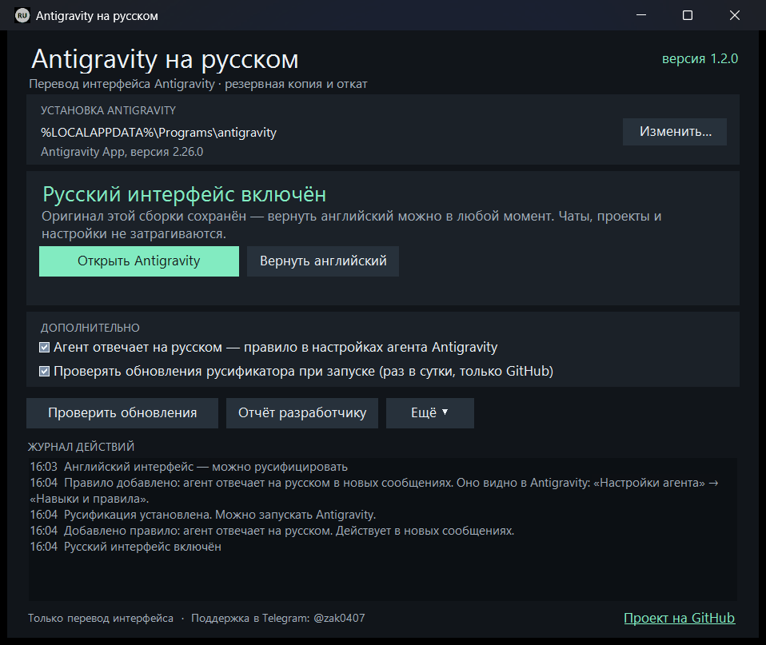

# Antigravity Russian

Небольшое Windows-приложение для русификации **Antigravity App**: сохраняет оригинал, переводит интерфейс и возвращает английский язык при необходимости.

**Это только перевод интерфейса на русский язык.** Русификатор не снимает ограничения по региону, не открывает модели и не меняет тариф. [Пошаговая инструкция: что и в каком порядке делать](https://github.com/ZakitKH0000/antigravity-russian/blob/main/docs/QUICKSTART.md) (также в ZIP).

> **Для доступа к Antigravity из России** рекомендуем отличный проект **[confeden/Antigravity](https://github.com/confeden/Antigravity)** — анлокер региона от автора, которого мы очень уважаем. Две программы дополняют друг друга и **не конфликтуют**: анлокер открывает доступ, наш русификатор переводит интерфейс. Мы проверили это вживую и по исходному коду анлокера — подробности в разделе [«Вместе с анлокером confeden/Antigravity»](#вместе-с-анлокером-confedenantigravity). Это независимые проекты; вопросы по анлокеру — в его [README](https://github.com/confeden/Antigravity#readme) и группе поддержки.

**[Скачать готовое приложение](https://github.com/ZakitKH0000/antigravity-russian/releases/latest)** · Windows 10/11 x64 · один EXE без установки · MIT

## Как пользоваться

1. Скачайте из Releases файл `AntigravityRussian-X.Y.Z-win-x64.exe` — это всё приложение, установка не нужна. Положите его в любую папку.
2. Запустите его. Он сам найдёт Antigravity: в сохранённом пути, среди запущенных процессов, в стандартных папках и в списке установленных программ. Если не нашёл — нажмите **«Выбрать Antigravity.exe…»**.
3. Нажмите **«Русифицировать»**. Оригинал сохранится автоматически, затем интерфейс станет русским.
4. Если Antigravity открыт, русификатор сам закроет его, включая значок в трее, а после перевода откроет снова. Если Antigravity уже скачал своё обновление, оно установится первым, и перевод встанет на новую версию.
5. Если стоит другой или прежний перевод, русификатор заменит его сам (подробнее — в разделе о безопасности).

Чтобы вернуть английский, нажмите **«Вернуть английский»**. Брату или другу достаточно этого же EXE из Releases: ваши резервные копии и настройки ему не нужны.



## Дополнительные возможности

- **Агент отвечает на русском.** При русификации добавляется глобальное правило Antigravity `~/.gemini/config/rules/antigravity-russian.md`: агент пишет по-русски ответы, вопросы, планы и названия шагов. Код, команды и пути остаются как есть. Правило видно в Antigravity в разделе «Настройки агента». Снимите флажок — русификатор удалит только свой файл; при «Вернуть английский» оно тоже удаляется.
- **Проверка обновлений при запуске.** Не чаще раза в сутки русификатор спрашивает у GitHub, нет ли новой версии, и показывает плашку. Устанавливается обновление только по вашему нажатию. Флажок можно снять.
- **Ярлык на рабочем столе.** Флажок «Ярлык „Русификатор Antigravity“ на рабочем столе» создаёт ярлык, который открывает русификатор; снимите флажок — ярлык удалится. Если EXE перенесён в другую папку, ярлык обновится при следующем запуске. Сам Antigravity запускайте как обычно, например через анлокер.

## Вместе с анлокером confeden/Antigravity

[confeden/Antigravity](https://github.com/confeden/Antigravity) — открытый анлокер региона: он позволяет аккаунту Google из любой страны, в том числе из России, пользоваться Antigravity без VPN и смены региона. Спасибо его автору за большую и аккуратную работу. Русификатор и анлокер работают одновременно и не мешают друг другу — это проверено в живом чате Antigravity 2.26.0 с обеими включёнными программами и по исходному коду анлокера:

- программы меняют **разные файлы**: анлокер — только `language_server.exe`/`agy.exe`, DNS-правила и свою службу-прокси; русификатор — только `resources/app.asar` (интерфейс) и, по флажку, своё правило языка агента;
- анлокер распаковывает `app.asar` лишь для старых версий Antigravity (до 2.4). Русификатор сохраняет признаки, по которым анлокер распознаёт новую версию, и отменяет русификацию, если перевод их нарушил бы; `language_server.exe`/`agy.exe`, DNS-правила и свою службу-прокси; русификатор — только `resources/app.asar`;
- анлокер распаковывает `app.asar` лишь для старых версий Antigravity (до 2.4). Русификатор сохраняет признаки, по которым анлокер распознаёт новую версию, и отменяет русификацию, если перевод их нарушил бы;
- русификатор не трогает сеть, прокси, DNS и службы. Если анлокер настроен (`AG_LS_PROXY`), а его служба не отвечает, окно русификатора подскажет запустить анлокер — без этого Antigravity не сможет войти в аккаунт;
- порядок не важен: можно сначала запустить анлокер, потом русификатор, и наоборот. После обновления Antigravity анлокер патчит его заново сам, а перевод включается кнопкой «Русифицировать»;
- откат одной программы не затрагивает другую: «Вернуть английский» возвращает только интерфейс, а выключение переключателей анлокера — только его изменения.

Ссылка на анлокер есть и в самом русификаторе: меню «Ещё» → «Анлокер региона confeden/Antigravity».

## Обновление самого русификатора

Начиная с **1.1.0** нажмите **«Проверить обновления»** (в 1.1.0 кнопка называется «Обновления»); с 1.2.0 проверка также выполняется при запуске. Приложение проверит последний стабильный релиз нашего GitHub, предложит скачать новую версию, сверит размер и SHA-256 из метаданных GitHub, проверит содержимое пакета обновления и номер EXE. После подтверждения русификатор закроется и откроется обновлённым. Резервные копии Antigravity не меняются. Предыдущий EXE сохраняется в `%LOCALAPPDATA%\AntigravityRussian\updates\`.

В версиях 1.0.x кнопки ещё нет: **один раз вручную** скачайте текущий EXE из Releases. Затем обновляйтесь из приложения. Если GitHub недоступен или папка русификатора защищена от записи, скачайте новый EXE вручную в доступную папку — резервные копии останутся в профиле пользователя. ZIP в Releases нужен только встроенному обновлению.

Если новый релиз добавил переводы, а Antigravity уже русифицирован, русификатор покажет «Доступен новый перевод» — нажмите **«Обновить перевод»** при закрытом Antigravity. Обновление EXE само не переписывает Antigravity.

## Поддержка и отчёт разработчику

Если что-то не работает, напишите автору лично в Telegram: **[@zak0407](https://t.me/zak0407)**.

Кнопка **«Отчёт разработчику»** показывает предпросмотр: версии программ, Windows, наличие резервной копии и последние коды действий/ошибок текущего сеанса. Тексты исключений, содержимое чатов, файлы, токены, имена пользователей и личные пути не включаются. Отчёт можно сохранить в TXT или скопировать.

**«Открыть Telegram с отчётом»** откроет личный чат автора с черновиком и скопирует текст как запасной вариант. Пользователь самостоятельно нажимает отправку в Telegram. Автоматической отправки и бота нет. Добавьте своими словами, что пытались сделать и что получилось; личные данные присылать не требуется.

## После обновления Antigravity

Antigravity обновляется сам: скачивает новую версию и ставит её, когда вы закрываете приложение. Установщик возвращает английский интерфейс — так и должно быть, перевод нужно включить для новой сборки заново.

Откройте русификатор. Он покажет «Antigravity обновился — включите русский снова»: нажмите «Русифицировать», оригинал новой сборки сохранится автоматически. Если обновление уже скачано или устанавливается, русификатор дождётся окончания установки и переведёт новую версию, а не ту, что сейчас будет заменена. Старый архив никогда не подставляется вместо новой версии; даже разные сборки с одинаковым номером версии имеют разные копии.

Если русификатор пишет «Перевод не виден: мешает папка resources\app», в установке есть распакованная папка `resources\app`: Electron загружает её вместо `app.asar`. Закройте Antigravity и переименуйте эту папку, например в `app.off`, не удаляя её.

Совместимость проверяется по структуре пакета. При существенном изменении архитектуры инструмент откажется изменять установку. Новые строки разработчиков могут оставаться английскими до обновления словаря.

## Что поддерживается

- Antigravity **App**, Electron-вариант с `resources/app.asar`, Windows x64.
- Словарь из **2 804 записей** проверен на установленной сборке **2.26.0**, включая шаги агента, запросы разрешений и вопросы в чате.
- Другие сборки обрабатываются только при совместимой структуре; поддержка всех будущих версий заранее не гарантируется.
- Это не расширение для VS Code и не русификатор всех продуктов, называющихся Antigravity.

Требуется .NET Framework 4.8, входящий в современные Windows 10/11. Python, Node.js и SDK пользователю приложения не нужны. Для установки Antigravity в Program Files могут потребоваться права администратора; обычная установка в профиль пользователя работает без них. Готовая сборка пока не имеет цифровой подписи издателя.

## Резервные копии и данные

Копии хранятся на компьютере пользователя:

```text
%LOCALAPPDATA%\AntigravityRussian\backups\<установка>\<SHA-256 оригинала>\
  original.asar   — неизменяемый оригинал
  russian.asar    — подготовленная русская сборка
  manifest.json  — версия и контрольные суммы
```

В Antigravity изменяется только `resources/app.asar`. Кроме него русификатор по флажку создаёт один свой файл — правило языка агента `~/.gemini/config/rules/antigravity-russian.md`. Чаты, проекты, авторизация, настройки моделей, исполняемые файлы и сетевые настройки не изменяются. Тексты сообщений, код, редакторы, терминальный вывод, названия файлов и значения полей ввода исключены из слоя перевода.

Переводы встроены в EXE. Копирование, русификация и откат работают локально. Сеть используется для GitHub: проверка обновлений при запуске (раз в сутки, можно выключить) и скачивание обновления по нажатию. Сервер обновлений Google используется только когда нужно заменить чужой перевод, а оригинала на компьютере нет. Ссылки справки и Telegram открываются по действию пользователя. Телеметрии нет. Обновления самого Antigravity не отключаются. Фоновых служб и задач планировщика нет.

Перед записью русификатор сам закрывает Antigravity этой установки: сначала просит окна закрыться, через несколько секунд завершает оставшиеся процессы, включая трей и language server. Незавершённая задача агента при этом прерывается. Скачанное обновление Antigravity ставится до перевода тем же установщиком, что и при обычном выходе из приложения, и только если он подписан Google LLC.

Если в Antigravity уже стоит другой или прежний перевод, «Русифицировать» заменит его сам. Русификатор ищет оригинал именно этой сборки: рядом с `app.asar` (например, `app.asar.bak`), в своих резервных копиях и в копиях прежнего скрипта v3 в «Документах», на рабочем столе и в «Загрузках». Подходит только архив, из которого получен установленный перевод: все файлы, кроме нескольких скриптов перевода, должны совпадать байт в байт, а скрипт перевода — начинаться с исходного текста. Если такого архива нет, русификатор скачивает официальный установщик Antigravity с сервера обновлений Google, сверяет размер и SHA-512, проверяет подпись Google LLC и переустанавливает Antigravity поверх. Чаты, проекты и настройки при этом сохраняются. Если пользуетесь анлокером confeden/Antigravity, после переустановки запустите его снова. Ручной **«Импорт копии прежней русификации…»** остаётся в меню «Ещё».

## Сборка из исходников

На Windows 10/11 x64:

```powershell
powershell.exe -NoProfile -ExecutionPolicy Bypass -File .\Build.ps1 -Test
```

Результат: `bin/AntigravityRussian.exe` (настройки среды встроены, `.exe.config` рядом необязателен). Скрипт использует компилятор .NET Framework из Windows, без NuGet и сетевых загрузок. Также есть проект `AntigravityRussian.sln` для Visual Studio с установленным targeting pack .NET Framework 4.8.

Для запуска из локальной папки проекта можно дважды нажать `Start.cmd`.

Собрать файлы релиза (`dist/`: один EXE и ZIP для встроенного обновления, оба с SHA-256):

```powershell
powershell.exe -NoProfile -ExecutionPolicy Bypass -File .\Package.ps1
```

## Разработка

- `src/PatchService.cs` — обнаружение установки, копирование, русификация, откат, проверка процессов и миграция.
- `src/Archive.cs` — чтение, целостность и пересборка ASAR с сохранением остальных файлов.
- `src/MainForm.cs` — интерфейс WinForms.
- `payload/` — словарь, слой перевода DOM и правила подписей нативных диалогов.
- `tests/Tests.cs` — независимые синтетические архивы и проверки жизненного цикла, без настоящих бинарников Antigravity.
- `docs/ARCHITECTURE.md` — устройство и границы совместимости.

При исправлении словаря меняйте `payload/dictionary.json`, затем запускайте `Sync-Payload.ps1` и тесты. Подписи, которые разрешено переводить внутри ответа агента (шаги, разрешения, карточки вопросов), дополнительно перечислены в `payload/chat-labels.json`; каждая из них должна быть в словаре. DOM-проверки слоя перевода: `node tests/overlay/overlay.test.cjs` при доступном пакете jsdom (через `NODE_PATH`). Оригинальные архивы, резервные копии, логи и личные настройки в Git не добавляются.

## Статус проекта

Текущая версия: **1.3.1**. Приложение и сценарии копирования/отката проверены локально; сборка и тесты запускаются также в GitHub Actions. Повреждённый подготовленный русский архив не мешает вернуть целый оригинал; при следующем применении он собирается заново. Ошибки и оставшиеся надписи можно сообщать через Issues или Telegram. Не прикладывайте токены, переписки, личные файлы или целые архивы установки.

Неофициальный проект; он не связан с Google и не изменяет доступность моделей, тарифы или региональные ограничения. Названия продуктов принадлежат их владельцам.
